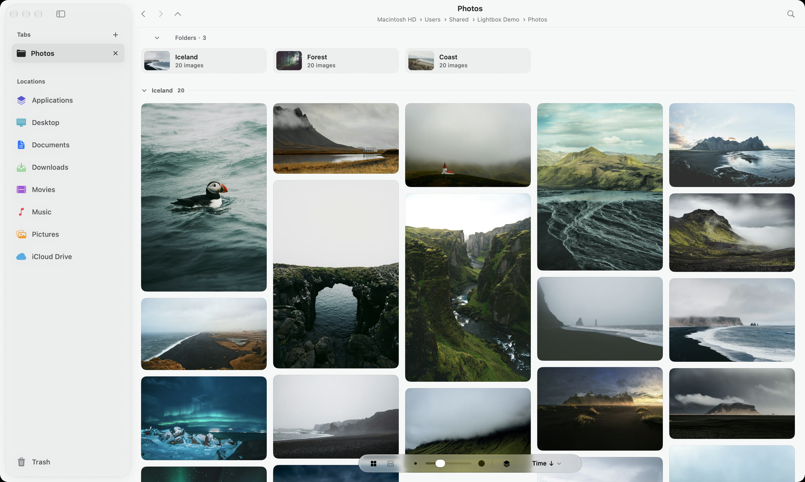
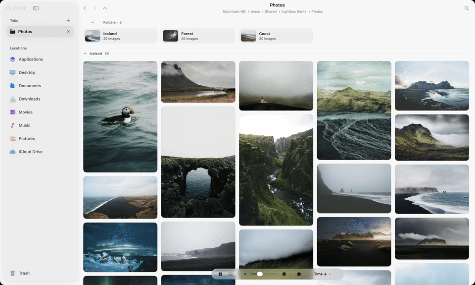
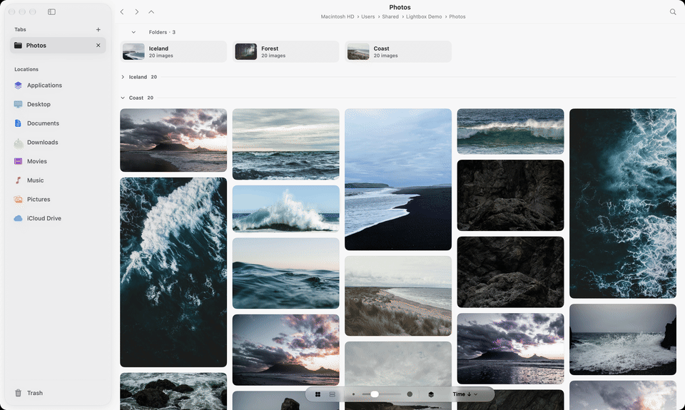

  

<h1 align="center">Lightbox</h1>

  <b>軽くて速い、Mac 向けの画像ビューア・写真ブラウザ。</b> 
  写真を読み込まず、いつものフォルダのまま閲覧・セレクト・整理できます。 
  Camera Raw で現像するフォトグラファーのための、無料の Adobe Bridge 代替。

  
  
  

  <a href="README.md">English</a> · <a href="README.zh-Hant.md">繁體中文</a> · <b>日本語</b>

<picture>
  <source media="(prefers-color-scheme: dark)" srcset=".github/media/hero-dark.jpg">
  
</picture>

## Lightbox を選ぶ理由

- **フォルダがそのままライブラリ。** Mac、外付けドライブ、NAS のどのフォルダもすぐに開けます。読み込みもコピーもカタログもないので、Finder や Photoshop など、ほかのアプリからも同じファイルのままです。
- **Camera Raw のワークフローのために。** Adobe Camera Raw や Lightroom で現像済みの写真がひと目でわかり、キーひとつでセレクトし、Photoshop を通して JPEG を一括書き出し。Bridge で実際によく使う機能だけを、軽快に。
- **macOS の一部のように。** ネイティブで起動が速く、ライト／ダーク、キーボード操作、タブ、Quick Look、カラータグ、取り消しが期待どおりの場所にあります。

## 機能

### ライブラリではなく、フォルダを見る

- タブ、ピン留めしたフォルダ、戻る／進む、よく使う場所とドライブを並べたサイドバー
- 写真の縦横比を保つメイソンリー表示と、列で並べ替えられるリスト表示
- **サブフォルダを含める**で撮影全体を一度に表示し、フォルダごとにグループ化。不要なグループは折りたたむと記憶されます
- サムネールサイズのスライダーと、両端のドットで 1 行 1 枚ずつ増減（⌘= / ⌘−）

### Camera Raw で現像したかひと目でわかる

- Camera Raw や Lightroom の現像設定がある写真に小さな印。RAW は `.xmp` サイドカー、JPEG・TIFF・DNG は埋め込み XMP から読み取ります（Bridge と同じ判定）
- **調整済み**／**未調整**で絞り込み、残りの作業がすぐわかります
- Lightbox で名前変更・コピー・移動・ゴミ箱に入れると、RAW の XMP サイドカーも一緒に動きます

### プレビュー、100% 表示、キーひとつでセレクト

- サムネールをクリックで大きく速いプレビュー、矢印キーで前後に移動
- **Z** で 100% 表示してピントを確認。ドラッグで見回し、連写を送っても同じ位置のまま
- **P** で残す、**X** で不採用、**U** で解除。Finder 標準のカラータグとして保存されるので、どこでも見えます
- カメラ・レンズ・露出情報と、似たカットを選ぶための比較トレイ

### すっきりした並べ替えとフィルタ

- 名前、追加日、サイズ、種類、ピクセルサイズ、タグで並べ替え
- 種類（写真・RAW・ビデオ・書類）、向き、長辺、追加日、ファイルサイズ、Camera Raw の状態、Finder のカラータグで絞り込み
- 有効なフィルタは小さなチップで表示し、ワンクリックで解除。ファイル名の検索はサブフォルダも対象

### Finder のように整理、しかも取り消せる

- 1 枚または一括の名前変更（置き換え・追加・名前と番号）、新規フォルダ、ゴミ箱に入れる。どれも ⌘Z で取り消し
- 写真をほかのタブへドラッグしてコピー・移動、どのアプリにもドラッグ可能
- Quick Look、Finder に表示、このアプリケーションで開く。画像以外のファイルも表示できます

### Photoshop で JPEG を一括書き出し

Bridge の**イメージプロセッサ**にあたる機能です。写真を選んで「JPEG として書き出す…」を選ぶと、Photoshop が 1 枚ずつ Camera Raw の設定を適用して JPEG で保存します。画質、sRGB への変換、長辺の上限も設定可能。元の画像は変わらず、既存のファイルを上書きすることもありません。それ以外の作業は「Photoshop で開く」ですぐに。

> Camera Raw の調整を描画できるのは Adobe のエンジンだけなので、書き出しには Photoshop が必要です。閲覧・セレクト・整理には不要です。

### Mac のために

- システムに合わせたライト／ダーク外観と、調整できるガラスの質感
- キーボードだけで操作でき、VoiceOver のラベルにも対応
- 英語、繁体字中国語、簡体字中国語、日本語のインターフェイス
- アップデートを自動確認し、インストール前に確認

## キーボードショートカット

| 操作 | キー | 操作 | キー |
| --- | --- | --- | --- |
| 新規タブ／タブを閉じる | ⌘T / ⌘W | プレビュー／Quick Look | スペース / ⌘Y |
| 戻る／進む | ⌘[ / ⌘] | プレビューを 100% 表示 | Z |
| 上のフォルダへ | ⌘↑ | 残す／不採用／解除 | P / X / U |
| フォルダへ移動 | ⇧⌘G | 名前を変更 | ⇧⌘R |
| 検索 | ⌘F | 新規フォルダ | ⇧⌘N |
| 並べ替えとフィルタ | ⌥⌘F | ゴミ箱に入れる | ⌘⌫ |
| サムネールを大きく／小さく | ⌘= / ⌘− | Photoshop で開く | ⌥⌘O |
| ギャラリー／リスト | ⌃⌘1 / ⌃⌘2 | JPEG として書き出す | ⇧⌘E |

## ダウンロード

最新版は **[Releases](https://github.com/a11oydyyy/Lightbox/releases/latest)** から入手できます。

| パッケージ | 動作環境 |
| --- | --- |
| `Lightbox-v*.zip` | Apple Silicon、macOS 15 以降 |
| `Lightbox-Intel-x86-v*.zip` | Intel または Apple Silicon、macOS 13 以降 |

Intel パッケージは両方のアーキテクチャを含み、Apple Silicon でもネイティブで動作します。各バージョンの署名状況と既知の制限はリリースノートをご覧ください。

## よくある質問

**Adobe Bridge の代わりになりますか？**
フォルダの閲覧、Camera Raw で現像済みかの確認、セレクト、JPEG の一括書き出しが目的ならなります。軽さと速さを保つため、キーワード、コレクション、出力テンプレートはあえて省いています。

**写真を読み込んだり変更したりしますか？**
しません。フォルダをそのまま読み取り、名前変更・移動・タグ付け・ゴミ箱など、指示したときだけファイルを変更します。名前変更・タグ付け・ゴミ箱への移動は取り消せます。タブ間でのファイル移動はまだ取り消せず、それ以前の取り消し履歴も消去されます。

**RAW ファイルに対応していますか？**
CR3、CR2、NEF、ARW、RAF、ORF、RW2、DNG など、macOS が読める形式に対応しています。プレビューは元の RAW を表示し、Camera Raw の調整は書き出し時に Photoshop が適用します。

**「プレビュー」や「写真」の代わりの画像ビューアとして使えますか？**
使えます。フォルダを直接開き、クリックでプレビュー、矢印キーで切り替え。ライブラリへの読み込みは一切ありません。

**外付けドライブや NAS でも使えますか？**
使えます。ネットワークや外付けのボリュームは控えめに読み込むので、大きな共有フォルダでも軽快です。

## フィードバック

不具合や提案は [Issues](https://github.com/a11oydyyy/Lightbox/issues) へ。Lightbox と macOS のバージョン、Mac のチップの種類を添えてください。

デモ写真は <a href="https://unsplash.com">Unsplash</a> のフォトグラファーによるものです。

キーワード：Mac 画像ビューア · 写真ブラウザ · Adobe Bridge 代替 · Camera Raw · XMP サイドカー · 写真セレクト · RAW ビューア · 一括リネーム · JPEG 一括書き出し
